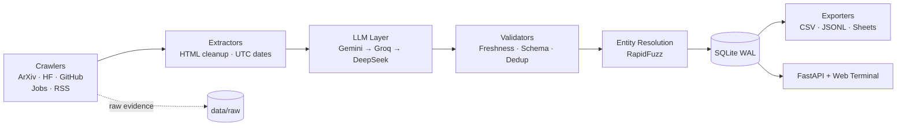
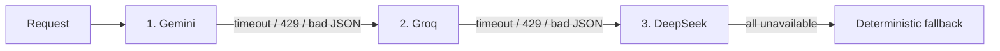

<div align="center">

# 🧠 AI Intelligence Data Pipeline

**An enterprise-grade, source-verifiable intelligence collection and processing platform for the AI ecosystem.**

[](https://www.python.org/)
[](https://docs.python.org/3/library/asyncio.html)
[](https://docs.pydantic.dev/)
[](https://fastapi.tiangolo.com/)
[](https://www.sqlite.org/)
[](https://www.docker.com/)
[](https://docs.pytest.org/)

[Quick Start](#-quick-start) •
[Features](#-key-features) •
[Architecture](#-architecture) •
[Web Terminal](#-aether-ai-intelligence-terminal) •
[API](#-api-reference) •
[Scaling](#-scaling-to-500000-records)

</div>

---

## 📑 Table of Contents

- [Overview](#-overview)
- [Key Features](#-key-features)
- [Architecture](#-architecture)
- [Quick Start](#-quick-start)
- [Configuration](#-configuration)
- [Running the Pipeline](#-running-the-pipeline)
- [Aether AI Intelligence Terminal](#-aether-ai-intelligence-terminal)
- [API Reference](#-api-reference)
- [Output Tabs & Files](#-output-tabs--files)
- [Entity Resolution](#-entity-resolution)
- [24-Hour Freshness Window](#-strict-24-hour-freshness-window)
- [Multi-Provider LLM Fallback](#-multi-provider-llm-fallback)
- [Testing](#-testing)
- [Docker Deployment](#-docker-deployment)
- [Scaling to 500,000+ Records](#-scaling-to-500000-records)
- [Documentation](#-documentation)
- [Contributing](#-contributing)
- [License](#-license)

---

## 🔭 Overview

The pipeline **discovers, extracts, validates, normalizes, deduplicates, and stores** intelligence across five critical AI domains, then exports six structured tabs to **Google Sheets, CSV, and JSONL**.

| # | Domain | Coverage | Source of truth |
|---|--------|----------|-----------------|
| 1 | 🚀 **AI Startups** | 1,000+ verifiable companies and venture-backed organizations | Crawled web sources |
| 2 | 🧩 **AI Products** | 1,000+ models, applications, and frameworks | Hugging Face, GitHub |
| 3 | 📄 **AI Research Papers** | 1,000+ preprints across ML disciplines | ArXiv |
| 4 | 💼 **AI Jobs** | Active postings verified in a rolling **24h UTC** window | Job boards |
| 5 | 📰 **AI News** | Articles and discussions verified in a rolling **24h UTC** window | RSS feeds |
| 6 | 🔗 **Entity Mapping Log** | Full audit trail of canonical name resolution | Generated by the pipeline |

---

## ✨ Key Features

- ⚡ **Fully asynchronous**: `asyncio`-based crawlers for ArXiv, Hugging Face, GitHub, job boards, and RSS.
- 🧾 **Source-verifiable**: raw crawler payloads are preserved as evidence in `data/raw/`.
- 🛡️ **Strict validation**: Pydantic v2 models with validators for schema compliance.
- 🕒 **Honest freshness**: publication timestamps are verified, and collection time is never substituted.
- 🧬 **Entity resolution**: RapidFuzz canonical matching with legal-suffix stripping and an auditable log.
- 🤖 **Resilient LLM layer**: Gemini → Groq → DeepSeek fallback, plus a deterministic mode with no keys.
- 🗄️ **WAL-mode SQLite** repository behind a PostgreSQL-ready interface.
- 📤 **Multi-format export**: CSV, JSONL, and optional live Google Sheets sync.
- 🖥️ **Built-in web terminal**: Bloomberg / Linear-style dark UI served by FastAPI.
- 🧪 **20+ unit and integration tests** covering schema, matching, dates, and freshness.

---

## 🏗️ Architecture



### Project Layout

```
ai-intelligence-pipeline/
├── config/
│   └── settings.py              # Pydantic BaseSettings & secret masking
├── src/
│   ├── crawlers/                # Async crawlers: ArXiv, HF, GitHub, Jobs, RSS
│   ├── extractors/              # HTML boilerplate stripping & UTC date parser
│   ├── llm/                     # Gemini/Groq/DeepSeek fallback & chunker
│   ├── models/                  # Pydantic v2 data models with validators
│   ├── entity_resolution/       # RapidFuzz canonical matcher & suffix stripper
│   ├── validators/              # Freshness window, dedup & schema validation
│   ├── database/                # WAL SQLite repository & PostgreSQL-ready interface
│   ├── exporters/               # 6-tab CSV, JSONL & Google Sheets exporters
│   ├── pipeline.py              # End-to-end async pipeline orchestrator
│   └── main.py                  # CLI and FastAPI endpoints
├── tests/                       # 20+ unit and integration tests
├── data/
│   ├── raw/                     # Preserved raw crawler evidence payloads
│   └── processed/               # 6 standardized CSV and JSONL files
└── docs/
    ├── architecture.md          # System design & 500k+ scalability transition
    └── limitations.md           # API limits & freshness constraints
```

---

## 🚀 Quick Start

### Prerequisites

| Requirement | Version | Required |
|-------------|---------|----------|
| Python | 3.11+ | ✅ |
| Git | any | ✅ |
| Docker & Docker Compose | recent | Optional |

### Installation

```bash
# 1. Clone the repository
git clone https://github.com/your-username/ai-intelligence-pipeline.git
cd ai-intelligence-pipeline

# 2. Create a virtual environment (uv or python3.11 venv)
uv venv --python 3.11 .venv
source .venv/bin/activate          # Windows: .venv\Scripts\activate

# 3. Install dependencies
uv pip install -r requirements.txt

# 4. Create your environment file
cp .env.example .env
```

### Verify with a smoke test

```bash
python src/main.py --quick-test
```

This collects ~15 records per category and verifies connectivity, validation, database insertion, and file exports.

---

## ⚙️ Configuration

All keys are **optional**. The pipeline has automatic fallbacks, so it runs with an empty `.env`.

```ini
ENVIRONMENT=development
LOG_LEVEL=INFO

# LLM Providers (priority: Gemini -> Groq -> DeepSeek)
GEMINI_API_KEY=your_gemini_api_key
GROQ_API_KEY=your_groq_api_key
DEEPSEEK_API_KEY=your_deepseek_api_key

# GitHub token (raises search rate limits)
GITHUB_TOKEN=your_github_token

# Google Sheets export (optional service account)
GOOGLE_APPLICATION_CREDENTIALS=
GOOGLE_SPREADSHEET_ID=
```

| Variable | Purpose | Default behavior if unset |
|----------|---------|---------------------------|
| `ENVIRONMENT` | Runtime profile | `development` |
| `LOG_LEVEL` | Logging verbosity | `INFO` |
| `GEMINI_API_KEY` | Primary LLM provider | Skip to Groq |
| `GROQ_API_KEY` | Secondary LLM provider | Skip to DeepSeek |
| `DEEPSEEK_API_KEY` | Tertiary LLM provider | Deterministic fallback |
| `GITHUB_TOKEN` | Higher GitHub search limits | Unauthenticated limits |
| `GOOGLE_APPLICATION_CREDENTIALS` | Service account JSON path | Sheets export disabled |
| `GOOGLE_SPREADSHEET_ID` | Target spreadsheet | Sheets export disabled |

> 🔐 Secrets are masked in logs and in the diagnostics view.

---

## ▶️ Running the Pipeline

| Mode | Command | Purpose |
|------|---------|---------|
| 🧪 **Smoke test** | `python src/main.py --quick-test` | ~15 records per category, fast end-to-end check |
| 🏭 **Full production run** | `python src/main.py --target-startups 1000 --target-products 1000 --target-papers 1000` | 1,000+ startups, products, and papers, plus all qualifying 24h jobs and news |
| 🌐 **API + Web UI** | `python src/main.py --api --port 8000` | Launches FastAPI and the web terminal |
| 🐳 **Docker** | `docker-compose up --build -d` | Containerized deployment |

### CLI flags

| Flag | Description |
|------|-------------|
| `--quick-test` | Accelerated run with ~15 records per category |
| `--target-startups N` | Target number of startups |
| `--target-products N` | Target number of products |
| `--target-papers N` | Target number of research papers |
| `--api` | Start the FastAPI server |
| `--port N` | Server port (used with `--api`) |

---

## 🖥️ Aether AI Intelligence Terminal

```bash
python src/main.py --api --port 8000
```

Open **http://localhost:8000** to access the full terminal interface.

| Feature | Description |
|---------|-------------|
| 🎨 **Bloomberg / Linear dark UI** | High-density terminal aesthetic, 6 overview metric cards, responsive tables |
| ⌨️ **Command palette** (`⌘K` / `Ctrl+K`) | Universal search across entities, papers, jobs, and tools |
| 📊 **Model benchmark comparison** | Select up to 4 models from Products for a side-by-side architectural matrix |
| 🧬 **Entity resolution & override** | Audit fuzzy-match scores and apply manual corrections via `POST /api/mappings/correct` |
| 🔍 **Inspection drawer** | Deep metadata view, permalinks (`#<tab>/<id>`), and raw JSON provenance viewer |
| 🔄 **11-stage ingestion modal** | Live progress bar, animated step indicators, streaming log terminal |
| 📈 **Chart.js analytics** | Funding stages, model task pipelines, ArXiv sub-disciplines, remote-work ratio, entity confidence tiers |
| 🩺 **Diagnostics & export hub** | DB size, WAL mode, table row counts, masked credentials, export download/regeneration |

---

## 📡 API Reference

| Endpoint | Method | Description |
|----------|--------|-------------|
| `/docs` | GET | Swagger UI |
| `/redoc` | GET | ReDoc documentation |
| `/health` | GET | Health check |
| `/stats` | GET | Pipeline and database statistics |
| `/api/mappings/correct` | POST | Apply a manual canonical-name correction |

Interactive docs: **Swagger** → `http://localhost:8000/docs` · **ReDoc** → `http://localhost:8000/redoc`

---

## 📦 Output Tabs & Files

Six structured tabs are exported with schemas matching the requirements.

| Tab | CSV | JSONL |
|-----|-----|-------|
| 1. Startups | `data/processed/startups.csv` | `data/processed/startups.jsonl` |
| 2. Products | `data/processed/products.csv` | `data/processed/products.jsonl` |
| 3. Research Papers | `data/processed/research_papers.csv` | `data/processed/research_papers.jsonl` |
| 4. Jobs | `data/processed/jobs.csv` | `data/processed/jobs.jsonl` |
| 5. News | `data/processed/news.csv` | `data/processed/news.jsonl` |
| 6. Entity Mapping Log | `data/processed/entity_mapping_log.csv` | `data/processed/entity_mapping_log.jsonl` |

> 📊 When `GOOGLE_APPLICATION_CREDENTIALS` and `GOOGLE_SPREADSHEET_ID` are set, all 6 tabs are also updated automatically through the Google Sheets API.

---

## 🧬 Entity Resolution

Canonical name resolution keeps duplicates out and makes every decision auditable.

- **Suffix stripping**: removes legal noise such as `Inc`, `LLC`, `Corp`, `Ltd`, `GmbH`, `PBC`, `Technologies`.
- **Fuzzy matching**: RapidFuzz token sorting with a configurable similarity threshold (**≥ 85%**).
- **Persistent audit log** recording:

| Field | Description |
|-------|-------------|
| `raw_name` | Name as found at the source |
| `canonical_name` | Resolved canonical entity |
| `entity_type` | Startup, product, etc. |
| `source` | Where the name originated |
| `confidence_score` | Match confidence |
| `resolution_method` | How the match was made |

Manual corrections can be applied from the web terminal or via `POST /api/mappings/correct`.

---

## 🕒 Strict 24-Hour Freshness Window

- News and job records need a **confirmed publication timestamp** within the preceding **24 hours (UTC)**.
- Records with unverified or stale dates are **rejected**, and the reason is written to the audit log.
- The system **never substitutes collection timestamps** for publication dates.

---

## 🤖 Multi-Provider LLM Fallback



- Strict priority: **Gemini → Groq → DeepSeek**.
- Automatic failover on **timeouts, HTTP 429 rate limits, and JSON errors**.
- A robust **deterministic fallback** runs when no API keys are present, so the pipeline always completes.

---

## 🧪 Testing

```bash
pytest -v tests/
```

The suite covers:

- ✅ Schema compliance
- ✅ Entity resolution and fuzzy matching
- ✅ Date extraction
- ✅ 24-hour freshness rules

---

## 🐳 Docker Deployment

```bash
docker-compose up --build -d
```

Then open `http://localhost:8000` (or your configured port).

---

## 📈 Scaling to 500,000+ Records

| Concern | Current | Enterprise-scale approach |
|---------|---------|---------------------------|
| **Database** | SQLite (WAL) | PostgreSQL 16 with range partitioning on `published_at` |
| **Queuing & workers** | In-process async | Redis + Celery across worker nodes |
| **Raw storage** | Local `data/raw/` | Object storage (AWS S3 / GCS) referenced by URI |
| **Deduplication** | In-process checks | Redis Bloom Filters for O(1) duplicate checks |
| **Candidate retrieval** | Fuzzy match | pgvector / Qdrant semantic nearest-neighbor before fuzzy matching |

Detailed diagrams: [`docs/architecture.md`](docs/architecture.md)

---

## 📚 Documentation

| Document | Contents |
|----------|----------|
| [`docs/architecture.md`](docs/architecture.md) | System design and the 500k+ scalability transition |
| [`docs/limitations.md`](docs/limitations.md) | Transparent API limits and freshness constraints |

---

## 🤝 Contributing

1. Fork the repository
2. Create a feature branch: `git checkout -b feature/your-feature`
3. Add tests for your change and run `pytest -v tests/`
4. Commit and push: `git commit -m "Add your feature"`
5. Open a pull request

---

## 📄 License

Add your license here (for example, MIT) and include a `LICENSE` file in the repository root.

---

<div align="center">

**Built with Python 3.11 · asyncio · Pydantic v2 · FastAPI · SQLite**

⭐ Star the repo if you find it useful.

</div>
