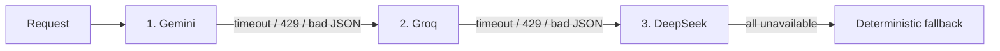

<div align="center">

# 🧠 AI Intelligence Data Pipeline

**An enterprise-grade, source-verifiable intelligence collection and processing platform for the AI ecosystem.**

[](https://www.python.org/)
[](https://docs.python.org/3/library/asyncio.html)
[](https://docs.pydantic.dev/)
[](https://fastapi.tiangolo.com/)
[](https://www.sqlite.org/)
[](https://www.docker.com/)
[](https://docs.pytest.org/)

**5,000+ records · 5 verified source feeds · 6 export tabs · 24h freshness guarantee**

</div>

---

## 🖼️ Preview

<div align="center">


*The Aether AI Intelligence Terminal: live feed, verified source panel, metric cards, tabbed datasets, filters, and one-click CSV export.*

</div>

---

## 🔭 Overview

The pipeline **discovers, extracts, validates, normalizes, deduplicates, and stores** intelligence across five critical AI domains, then exports six structured tabs to **Google Sheets, CSV, and JSONL**.

| # | Domain | Coverage | Source of truth |
|---|--------|----------|-----------------|
| 1 | 🚀 **AI Startups** | 1,000+ verifiable companies and venture-backed organizations | GitHub repos, web sources |
| 2 | 🧩 **AI Products** | 1,000+ models, applications, and frameworks | Hugging Face Hub |
| 3 | 📄 **AI Research Papers** | 1,000+ preprints (`cs.AI` / `cs.LG` / `cs.CV`) | arXiv |
| 4 | 💼 **AI Jobs** | Active postings verified in a rolling **24h UTC** window | Career portals |
| 5 | 📰 **AI News** | Articles and discussions verified in a rolling **24h UTC** window | Lab and tech feeds |
| 6 | 🔗 **Entity Mapping Log** | Full audit trail of canonical name resolution | Generated by the pipeline |

---

## ✨ Feature Highlights

### 🛰️ Data Collection
- ⚡ **Fully asynchronous** crawlers for arXiv, Hugging Face, GitHub, job boards, and RSS.
- 🧾 **Evidence preserved**: raw payloads are stored in `data/raw/` so every record can be traced to its source.
- 🔁 **Rate-limit aware**: optional GitHub token raises search limits, with graceful degradation without one.

### 🛡️ Data Quality
- ✅ **Pydantic v2 validation** on every record.
- 🕒 **Honest freshness**: confirmed publication timestamps only, and collection time is never substituted.
- 🧬 **Entity resolution**: RapidFuzz canonical matching with legal-suffix stripping and a confidence score per match.
- 🧹 **Deduplication** across sources, with explicit rejection reasons written to the audit log.

### 🤖 Intelligence Layer
- 🔀 **Multi-provider LLM fallback**: Gemini → Groq → DeepSeek.
- 🧱 **Deterministic mode**: runs end-to-end with zero API keys.
- ✂️ **Smart chunking** for long documents before LLM extraction.

### 🖥️ Web Terminal (Aether)
- 🔎 **Global search** with `⌘K` / `Ctrl+K` across papers, startups, products, jobs, and news.
- 🗂️ **Tabbed datasets** with live row counts: Startups, AI Products, Research Papers, AI Jobs (24h), News (24h), Entity Mappings, Bookmarks.
- ⭐ **Bookmarks**: star any row to save it to the Bookmarks tab.
- 🎚️ **Filters, stage dropdown, and sort** on the active dataset.
- 📥 **One-click CSV export** per tab, plus a full export hub.
- 🟠 **Run Pipeline** button with a live "Sync Xm ago" indicator.
- 📊 **Interactive analytics** powered by Chart.js.
- 🔍 **Inspection drawer** with deep metadata, permalinks, and raw JSON provenance.
- 🧬 **Manual entity overrides** from the UI or API.

### 📤 Export & Integration
- 📁 CSV and JSONL for every tab.
- 📊 Optional live Google Sheets sync through a service account.
- 🔌 REST API with Swagger and ReDoc docs.

---

## 🏗️ Architecture


### Ingestion Stages

The web terminal visualizes the run as an 11-stage ingestion flow:

| Stage | Description |
|:-----:|-------------|
| 1 | Discover sources and targets |
| 2 | Crawl feeds and APIs asynchronously |
| 3 | Preserve raw evidence payloads |
| 4 | Strip HTML boilerplate and extract text |
| 5 | Parse and verify UTC publication dates |
| 6 | Structure records with the LLM layer |
| 7 | Validate against Pydantic schemas |
| 8 | Enforce the 24-hour freshness window |
| 9 | Resolve entities and write the mapping log |
| 10 | Deduplicate and persist to the database |
| 11 | Export CSV, JSONL, and Google Sheets |

### Project Layout

```
ai-intelligence-pipeline/
├── config/
│   └── settings.py              # Pydantic BaseSettings & secret masking
├── src/
│   ├── crawlers/                # Async crawlers: arXiv, HF, GitHub, Jobs, RSS
│   ├── extractors/              # HTML boilerplate stripping & UTC date parser
│   ├── llm/                     # Gemini/Groq/DeepSeek fallback & chunker
│   ├── models/                  # Pydantic v2 data models with validators
│   ├── entity_resolution/       # RapidFuzz canonical matcher & suffix stripper
│   ├── validators/              # Freshness window, dedup & schema validation
│   ├── database/                # WAL SQLite repository & PostgreSQL-ready interface
│   ├── exporters/               # 6-tab CSV, JSONL & Google Sheets exporters
│   ├── pipeline.py              # End-to-end async pipeline orchestrator
│   └── main.py                  # CLI and FastAPI endpoints
├── tests/                       # 20+ unit and integration tests
├── data/
│   ├── raw/                     # Preserved raw crawler evidence payloads
│   └── processed/               # 6 standardized CSV and JSONL files
├── docs/
│   ├── screenshots/             # README preview images
│   ├── architecture.md          # System design & 500k+ scalability transition
│   └── limitations.md           # API limits & freshness constraints
└── README.md
```

---

## 🚀 Quick Start

### Prerequisites

| Requirement | Version | Required |
|-------------|---------|----------|
| Python | 3.11+ | ✅ |
| Git | any | ✅ |
| Docker & Docker Compose | recent | Optional |

### Installation

```bash
# 1. Clone the repository
git clone https://github.com/your-username/ai-intelligence-pipeline.git
cd ai-intelligence-pipeline

# 2. Create a virtual environment (uv or python3.11 venv)
uv venv --python 3.11 .venv
source .venv/bin/activate          # Windows: .venv\Scripts\activate

# 3. Install dependencies
uv pip install -r requirements.txt

# 4. Create your environment file
cp .env.example .env
```

### Verify with a smoke test

```bash
python src/main.py --quick-test
```

Collects ~15 records per category and verifies connectivity, validation, database insertion, and file exports.

### See it in the browser

```bash
python src/main.py --api --port 8000
# open http://localhost:8000
```

---

## ⚙️ Configuration

All keys are **optional**. The pipeline has automatic fallbacks, so it runs with an empty `.env`.

```ini
ENVIRONMENT=development
LOG_LEVEL=INFO

# LLM Providers (priority: Gemini -> Groq -> DeepSeek)
GEMINI_API_KEY=your_gemini_api_key
GROQ_API_KEY=your_groq_api_key
DEEPSEEK_API_KEY=your_deepseek_api_key

# GitHub token (raises search rate limits)
GITHUB_TOKEN=your_github_token

# Google Sheets export (optional service account)
GOOGLE_APPLICATION_CREDENTIALS=
GOOGLE_SPREADSHEET_ID=
```

| Variable | Purpose | If unset |
|----------|---------|----------|
| `ENVIRONMENT` | Runtime profile | `development` |
| `LOG_LEVEL` | Logging verbosity | `INFO` |
| `GEMINI_API_KEY` | Primary LLM provider | Skip to Groq |
| `GROQ_API_KEY` | Secondary LLM provider | Skip to DeepSeek |
| `DEEPSEEK_API_KEY` | Tertiary LLM provider | Deterministic fallback |
| `GITHUB_TOKEN` | Higher GitHub search limits | Unauthenticated limits |
| `GOOGLE_APPLICATION_CREDENTIALS` | Service account JSON path | Sheets export disabled |
| `GOOGLE_SPREADSHEET_ID` | Target spreadsheet | Sheets export disabled |

> 🔐 Secrets are masked in logs and in the diagnostics view.

---

## ▶️ Running the Pipeline

| Mode | Command | Purpose |
|------|---------|---------|
| 🧪 **Smoke test** | `python src/main.py --quick-test` | ~15 records per category, fast end-to-end check |
| 🏭 **Full production run** | `python src/main.py --target-startups 1000 --target-products 1000 --target-papers 1000` | 1,000+ startups, products, and papers, plus all qualifying 24h jobs and news |
| 🌐 **API + Web UI** | `python src/main.py --api --port 8000` | Launches FastAPI and the web terminal |
| 🐳 **Docker** | `docker-compose up --build -d` | Containerized deployment |

| Flag | Description |
|------|-------------|
| `--quick-test` | Accelerated run with ~15 records per category |
| `--target-startups N` | Target number of startups |
| `--target-products N` | Target number of products |
| `--target-papers N` | Target number of research papers |
| `--api` | Start the FastAPI server |
| `--port N` | Server port (used with `--api`) |

---

## 🖥️ Aether AI Intelligence Terminal

| Area | What you get |
|------|--------------|
| **Header bar** | Version badge, global search (`⌘K`), live sync status, **Run Pipeline** button |
| **Live Intelligence Feed** | Headline summary of total records and the sources they came from |
| **Verified Source Feeds** | GitHub (open-source startups), Hugging Face (models and spaces), arXiv (`cs.AI` / `cs.LG` / `cs.CV`), Career Portals (24h verified engineering), Industry Feeds (24h lab and venture updates) |
| **Metric cards** | Startups, Products, Papers, Jobs (24h), News (24h), Entity Mappings |
| **Dataset tabs** | Startups, AI Products, Research Papers, AI Jobs, News, Entity Mappings, Bookmarks, each with a live count |
| **Table controls** | Text filter, stage dropdown, sort selector, Export CSV |
| **Row actions** | ⭐ Save, **Visit ↗** to the source website, open the inspection drawer |
| **Command palette** | `⌘K` / `Ctrl+K` universal search |
| **Model comparison** | Select up to 4 models from Products for a side-by-side matrix |
| **Entity audit** | Review fuzzy-match scores and correct mappings manually |
| **Analytics** | Funding stages, model task pipelines, arXiv sub-disciplines, remote ratio, entity confidence tiers |
| **Diagnostics** | DB size, WAL mode, table row counts, masked credentials, export regeneration |

---

## 📡 API Reference

| Endpoint | Method | Description |
|----------|--------|-------------|
| `/docs` | GET | Swagger UI |
| `/redoc` | GET | ReDoc documentation |
| `/health` | GET | Health check |
| `/stats` | GET | Pipeline and database statistics |
| `/api/mappings/correct` | POST | Apply a manual canonical-name correction |

Interactive docs: **Swagger** → `http://localhost:8000/docs` · **ReDoc** → `http://localhost:8000/redoc`

---

## 📦 Output Tabs & Files

| Tab | CSV | JSONL |
|-----|-----|-------|
| 1. Startups | `data/processed/startups.csv` | `data/processed/startups.jsonl` |
| 2. Products | `data/processed/products.csv` | `data/processed/products.jsonl` |
| 3. Research Papers | `data/processed/research_papers.csv` | `data/processed/research_papers.jsonl` |
| 4. Jobs | `data/processed/jobs.csv` | `data/processed/jobs.jsonl` |
| 5. News | `data/processed/news.csv` | `data/processed/news.jsonl` |
| 6. Entity Mapping Log | `data/processed/entity_mapping_log.csv` | `data/processed/entity_mapping_log.jsonl` |

> 📊 When `GOOGLE_APPLICATION_CREDENTIALS` and `GOOGLE_SPREADSHEET_ID` are set, all 6 tabs are also updated through the Google Sheets API.

---

## 🧬 Entity Resolution

- **Suffix stripping**: removes legal noise such as `Inc`, `LLC`, `Corp`, `Ltd`, `GmbH`, `PBC`, `Technologies`.
- **Fuzzy matching**: RapidFuzz token sorting with a configurable threshold (**≥ 85%**).
- **Persistent audit log**:

| Field | Description |
|-------|-------------|
| `raw_name` | Name as found at the source |
| `canonical_name` | Resolved canonical entity |
| `entity_type` | Startup, product, etc. |
| `source` | Where the name originated |
| `confidence_score` | Match confidence |
| `resolution_method` | How the match was made |

Manual corrections go through the web terminal or `POST /api/mappings/correct`.

---

## 🕒 Strict 24-Hour Freshness Window

- News and job records need a **confirmed publication timestamp** within the preceding **24 hours (UTC)**.
- Stale or unverified records are **rejected**, and the reason is written to the audit log.
- The system **never substitutes collection timestamps** for publication dates.

---

## 🤖 Multi-Provider LLM Fallback



---

## 🧪 Testing

```bash
pytest -v tests/
```

Covers schema compliance, entity resolution and fuzzy matching, date extraction, and 24-hour freshness rules.

---

## 🐳 Docker Deployment

```bash
docker-compose up --build -d
```

Then open `http://localhost:8000`.

---

## 📈 Scaling to 500,000+ Records

| Concern | Current | Enterprise-scale approach |
|---------|---------|---------------------------|
| **Database** | SQLite (WAL) | PostgreSQL 16 with range partitioning on `published_at` |
| **Queuing & workers** | In-process async | Redis + Celery across worker nodes |
| **Raw storage** | Local `data/raw/` | Object storage (AWS S3 / GCS) referenced by URI |
| **Deduplication** | In-process checks | Redis Bloom Filters for O(1) duplicate checks |
| **Candidate retrieval** | Fuzzy match | pgvector / Qdrant nearest-neighbor before fuzzy matching |

Detailed diagrams: [`docs/architecture.md`](docs/architecture.md)

---

## 🛠️ Troubleshooting

| Problem | Fix |
|---------|-----|
| Preview image missing on GitHub | Save the screenshot to `docs/screenshots/dashboard.png` and commit it |
| GitHub rate-limit errors | Set `GITHUB_TOKEN` in `.env` |
| LLM calls failing | Check provider keys; the pipeline falls back automatically |
| No jobs or news in output | Items outside the 24h UTC window are rejected, so check the audit log |
| Google Sheets not updating | Verify `GOOGLE_APPLICATION_CREDENTIALS` and `GOOGLE_SPREADSHEET_ID`, and share the sheet with the service account |
| Port already in use | Run with a different `--port` |

---

## 🗺️ Roadmap

- [ ] PostgreSQL backend with partitioning
- [ ] Redis + Celery distributed workers
- [ ] Semantic search with pgvector / Qdrant
- [ ] Scheduled runs with change alerts
- [ ] Saved views and shareable filter links
- [ ] Webhook and Slack notifications for new items

---

## 📚 Documentation

| Document | Contents |
|----------|----------|
| [`docs/architecture.md`](docs/architecture.md) | System design and the 500k+ scalability transition |
| [`docs/limitations.md`](docs/limitations.md) | Transparent API limits and freshness constraints |

---

## 🤝 Contributing

1. Fork the repository
2. Create a feature branch: `git checkout -b feature/your-feature`
3. Add tests and run `pytest -v tests/`
4. Commit and push your changes
5. Open a pull request

---

## 📄 License

Add your license here (for example, MIT) and include a `LICENSE` file in the repository root.

---

<div align="center">

**Built with Python 3.11 · asyncio · Pydantic v2 · FastAPI · SQLite**

⭐ Star the repo if you find it useful.

</div>
